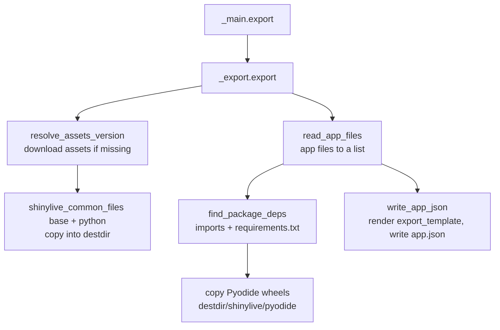

# Architecture

## What the package does

shinylive turns a Shiny for Python app folder into a static website. In the
browser, [Pyodide](https://pyodide.org/) runs Python, and the Shinylive web
assets run the app inside a service worker. No Python server is needed.

There are four related projects. This repo is only the second one.

| Project | Role |
|---|---|
| [posit-dev/shinylive](https://github.com/posit-dev/shinylive) | The web assets (JavaScript, Pyodide, webR, pyright). Released as `shinylive-<version>.tar.gz`. |
| [posit-dev/py-shinylive](https://github.com/posit-dev/py-shinylive) | This package. Downloads the assets, exports Python apps, and makes shinylive.io URLs. |
| [posit-dev/r-shinylive](https://github.com/posit-dev/r-shinylive) | The R twin. Much of it was ported from this package. |
| [quarto-ext/shinylive](https://github.com/quarto-ext/shinylive) | Quarto extension. Runs `shinylive extension ...` for `shinylive-python` code blocks. |

The public Python API is small: `shinylive/__init__.py` exports
`ShinyliveApp`, `url_encode()`, and `url_decode()`. Everything else is reached
through the `shinylive` command line (`shinylive._main:main`, a `click`
group). Modules start with `_` and are private, but `_export.export()` and
some `_assets` functions are imported by other tools, so keep their
signatures stable.

## Main flows

### `shinylive export APPDIR DESTDIR`

1. Resolve the assets version (an exact version, a series like `"0.10.*"`,
   or `"latest"`) to an exact version, download it if needed, and make it the
   version for the rest of the process (`set_assets_version()`).
2. Copy the shared asset files into `destdir`. Files already there are not
   overwritten.
3. Read every app file into a `FileContentJson` dict (text or base64 binary).
4. Find the Pyodide packages the app needs (from its imports and
   `requirements.txt`) and copy their wheels into
   `destdir/shinylive/pyodide/`. `--full-shinylive` copies every package.
5. Render the export template (`index.html`, `edit/index.html`) into
   `destdir/<subdir>` and write `app.json` there.

Several apps can share one `destdir` by using different `--subdir` values.
They share the assets and the Pyodide packages. See `export.md`.

### `shinylive extension <cmd>`

The Quarto extension runs `shinylive extension info` once per document, then
`base-htmldeps`, `language-resources`, and `app-resources` (one process each).
Each prints one JSON value to stdout. Only `info` checks GitHub and downloads;
the others reuse the version that `info` saved in `versions.json`. The JSON
shape must match what r-shinylive prints for `shinylive-r` blocks. See
`quartoExtension.md`.

### Assets cache

Assets live in `appdirs.user_cache_dir("shinylive")`, one folder per version:
`shinylive-<version>/`. They are downloaded from the posit-dev/shinylive
GitHub release the first time a version is needed. The default is the series
`SHINYLIVE_ASSETS_VERSION_DEFAULT` in `shinylive/_version/__init__.py`,
resolved to the newest matching release with a GitHub check at most once a
day (`versions.json`); the `SHINYLIVE_ASSETS_VERSION` environment variable
overrides it. The cache folder and `versions.json` are shared with
r-shinylive. See `assets.md`.

### `shinylive url encode|decode`

Builds or reads shinylive.io URLs: the app files as JSON, compressed with
lz-string, in the URL hash. No assets are needed. See `shinyliveUrls.md`.

## Package structure

| File | What it holds |
|---|---|
| `shinylive/_main.py` | The `click` CLI: `export`, `assets ...`, `extension ...`, `url ...`, and hidden defunct commands |
| `shinylive/_export.py` | `export()`, the main entry point; `check_subdir()` |
| `shinylive/_app_json.py` | `read_app_files()`, `write_app_json()`; the `FileContentJson` and `AppInfo` types |
| `shinylive/_utils.py` | `create_copy_fn()`, `copy_file_and_substitute()` (mustache), `comparable_path()`, `path_length()`, `listdir_recursive()`, `tar_safe_extractall()`, `print_as_json()` |
| `shinylive/_assets.py` | Download, cache, install, and remove assets; asset paths |
| `shinylive/_assets_version.py` | Version inputs, `versions.json`, the GitHub check, `resolve_assets_version()`, `assets_version()` |
| `shinylive/_version/__init__.py` | `SHINYLIVE_PACKAGE_VERSION`, `SHINYLIVE_ASSETS_VERSION_DEFAULT`, `SHINYLIVE_ASSETS_VERSION_FALLBACK` |
| `shinylive/_deps.py` | Lists asset files (`shinylive_common_files()`), builds Quarto HTML dependencies, and finds Pyodide packages |
| `shinylive/_url.py` | `ShinyliveApp`, `url_encode()`, `url_decode()` |
| `shinylive/__init__.py` | Public API and `__version__` |

Other folders:

- `tests/` - pytest tests; `tests/app/` is a small app used only by the
  deploy-app workflow test. See `testing.md`.
- `examples/` and `.github/workflows/deploy-app.yaml` - the reusable GitHub
  Actions workflow for users; see `ciAndTooling.md`.

## Key design points

- **Assets are not in the package.** They are hundreds of MB, so they are
  downloaded to a user cache on first use. Anything that touches assets can
  hit the network.
- **One assets version per process.** `assets_version()` resolves once and
  then returns the same version. `export()` and the Quarto commands (except
  `extension info`, which passes the version on directly) set it with
  `set_assets_version()`, which also clears the cached
  `pyodide-lock.json` data in `_deps.py`.
- **Export is additive.** Re-exporting into the same `destdir` keeps files
  that are already there, and only prints a message if an asset file differs.
- **Plain dicts with `TypedDict` types** are used for file contents, app info,
  and HTML dependencies, so they turn into JSON with `json.dumps()`.
- **Strict typing.** `pyrightconfig.json` uses `"typeCheckingMode": "strict"`.

## Where to read next

| File(s) | Doc |
|---|---|
| `_export.py`, `_app_json.py`, `_utils.py`, `_main.export` | `export.md` |
| `_assets.py`, `_assets_version.py`, `_version/`, `_main` `assets` commands | `assets.md` |
| `_deps.py` package detection (`find_package_deps()` and helpers) | `pyodidePackages.md` |
| `_deps.py` HTML dependencies, `_main` `extension` commands | `quartoExtension.md` |
| `_url.py`, `_main` `url` commands | `shinyliveUrls.md` |
| `tests/` | `testing.md` |
| `.github/`, `examples/`, `Makefile`, `setup.cfg`, `CHANGELOG.md` | `ciAndTooling.md` |

## Pitfalls

- **Two version numbers, and a third for packages.** `assets_version()` is the
  web assets version (like `0.10.16`). `SHINYLIVE_PACKAGE_VERSION` is this
  package's version (like `0.8.13`). The Pyodide packages have their own
  versions, read from the assets' `pyodide-lock.json`.
- **`SHINYLIVE_ASSETS_VERSION` beats the default series.** A stale env var in
  your shell makes tests and exports use another assets version.
- **stdout belongs to Quarto.** Inside `shinylive extension` commands, only the
  final JSON may go to stdout. Print anything else to stderr.
- **Some tests need the real assets.** They download them on first run and
  are skipped in CI except on release. Most tests use the offline
  `fake_assets` fixture instead; see `testing.md`.
